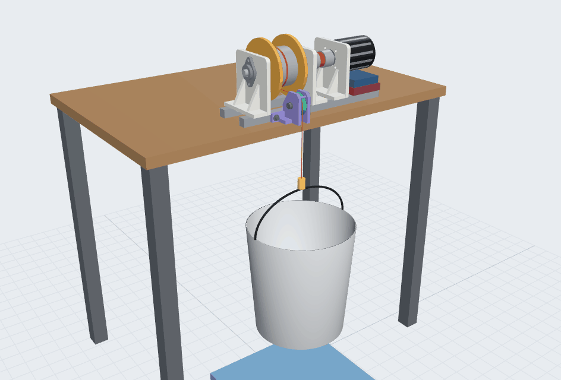

# 風箏發電地面站捲線器

復現 [KitesForFuture/powerplant](https://github.com/KitesForFuture/powerplant)（尾座式風箏 + 地面站捲線器的空中風能發電系統）時，我自己做的機械部分。原版的飛控和地面站代碼請直接看原版倉庫，這裏不重複上傳。



## 目錄

```
機械設計/
├── 捲線器/          直驅捲線器本體（已裝好）
│   ├── 文檔/        設計文檔、3D 網頁模型
│   ├── 打印件/      要打印的 STL、打印公差測試片、Bambu 工程文件
│   ├── 外購件示意/  標準件的示意模型（裝配用）
│   ├── 腳本/        生成零件和總裝的 SolidWorks 腳本
│   └── *.SLDPRT / 捲線器_總裝.SLDASM / 捲線器_總裝.STEP
└── 臺架/            桌邊測試臺架：轉向滑輪 + 重物，用來標定電流 → 線拉力
    ├── 文檔/        設計文檔、3D 網頁模型、動圖
    ├── 打印件/      滑輪、滑輪座的 STL
    ├── 腳本/        生成滑輪和滑輪座的 SolidWorks 腳本
    └── 滑輪.SLDPRT / 滑輪座.SLDPRT
```

## 捲線器

- 80100 外轉子電機（Kv 50）**直驅**，經梅花聯軸器帶動 Ø15 捲筒軸；捲筒軸由兩個 KFL002 法蘭軸承支撐，線拉力不經過電機軸承。
- 捲筒：6061 鋁管 Ø90 × 3 × 68，兩端插進 PLA 打印的 Ø140 擋板；抱緊式法蘭聯軸器傳扭。
- 立板、擋板都是 PLA 打印，底座是兩根 400 mm 2020 鋁型材。
- 線：Dyneema Ø1.0，現階段 50 m。預計線拉力係數 3.6–4.2 N/A，待臺架實測。
- 詳細尺寸、物料清單、裝配步驟：[捲線器設計文檔](機械設計/捲線器/文檔/捲線器設計文檔_2026-10-20.md)

## 臺架

- 捲線器和一個打印的轉向滑輪座用兩根 2020 橫樑連成一個框，F 夾夾在桌邊；線經滑輪轉向下，吊 0–10 kg 槓鈴片。
- 用途：標定「電機電流 → 線拉力」，以及帶載測試臺架專用的 VESC lisp。
- 詳細設計、採購清單、標定方法：[臺架設計文檔](機械設計/臺架/文檔/臺架設計文檔_2026-10-30.md)

## 3D 網頁模型

- `機械設計/捲線器/文檔/捲線器_網頁3D模型.html`
- `機械設計/臺架/文檔/臺架_網頁3D模型.html`（可調電流模擬重物升降）

GitHub 上只顯示 HTML 源碼。下載後用電腦上的 Chrome 或 Edge 打開；需要聯網，3D 程式庫從網上載入。

## 腳本

`腳本/` 裏的 Python 腳本通過 COM 驅動 SolidWorks 2024 生成零件、總裝並做尺寸檢查。它們依賴我本機的一套 SolidWorks 自動化輔助庫（不在這個倉庫裏），所以別人不能直接運行，主要作為建模參數和步驟的記錄。

## 進度

- [x] 捲線器設計、打印、組裝
- [x] 臺架設計和建模
- [ ] 臺架打印、採購、搭建
- [ ] VESC 首次通電、FOC 參數檢測
- [ ] 臺架標定、臺架專用 lisp
- [ ] 排線機構、聯軸器防護罩、野外地錨
